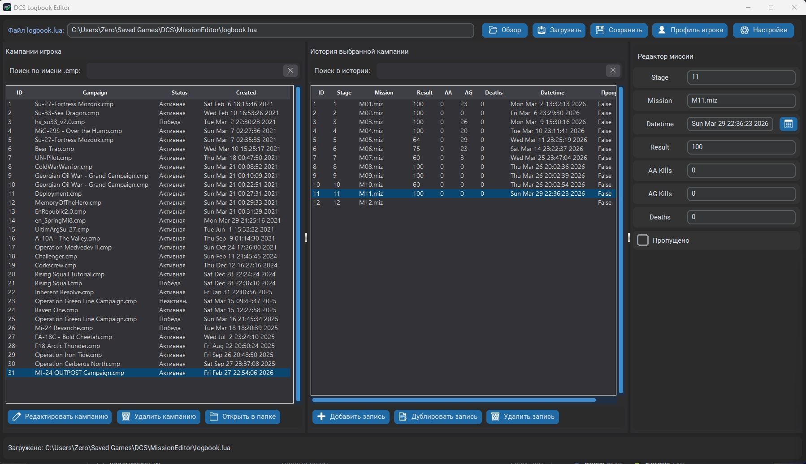

# DCS Logbooker

**English** · [Русский](#русский)

DCS Logbooker is a DCS Logbook Editor — a Python app for working with the DCS World `logbook.lua` file:

- reads a large `logbook.lua`;
- view and edit campaigns and mission history;
- add new entries based on an existing one;
- add the "next mission" (suggests the next `stage` automatically);
- search and filter campaigns and mission history;
- save with an automatic backup of the original file.

## Download

Download and run [Logbooker_1.0.exe](https://github.com/dinosmike/Logbooker/releases/download/DCS_world/Logbooker_1.0.exe)

## Path

By default the app fills in the usual path for the current Windows user, for example:

`%USERPROFILE%\Saved Games\DCS\MissionEditor\logbook.lua`

You can pick another file with the **Browse** button.

## How to use

1. Press **Load**.
2. Select a campaign in the top table.
3. Edit:
   - the campaign;
   - history entries;
   - the player profile (on the right).
4. To add, use:
   - **Add campaign based on sample**;
   - **Add entry based on sample**;
   - **Add next mission** (prefilled with `stage + 1`).
5. Press **Save (with backup)**.

On saving, a backup file is created:

`logbook.backup_YYYYMMDD_HHMMSS.lua`

## Important

- The app saves the table in normalized Lua format (structure and values are kept, comments from the original file are not).
- A backup of the original is always created before saving.

---

## Русский

DCS Logbooker - это DCS Logbook Editor, приложение на Python для работы с файлом `logbook.lua`:

- чтение большого `logbook.lua`;
- просмотр и редактирование кампаний/истории;
- добавление новых записей по образцу;
- добавление "следующей миссии" (автоматически предлагает следующий `stage`);
- поиск/фильтрация по кампаниям и по истории миссий;
- сохранение с автоматическим бэкапом исходного файла.

## Запуск

Скачать и запустить [Logbooker_1.0.exe](https://github.com/dinosmike/Logbooker/releases/download/DCS_world/Logbooker_1.0.exe)

## Путь
По умолчанию приложение подставляет типичный путь для текущего пользователя Windows, например:

`%USERPROFILE%\Saved Games\DCS\MissionEditor\logbook.lua`

Можно выбрать другой файл кнопкой **Обзор**.

## Как работать

1. Нажмите **Загрузить**.
2. Выберите кампанию в верхней таблице.
3. Редактируйте:
   - кампанию;
   - записи истории;
   - профиль игрока (справа).
4. Для добавления используйте:
   - **Добавить кампанию по образцу**;
   - **Добавить запись по образцу**;
   - **Добавить следующую миссию** (предзаполнение с `stage + 1`).
5. Нажмите **Сохранить (с бэкапом)**.

При сохранении создается бэкап-файл вида:

`logbook.backup_YYYYMMDD_HHMMSS.lua`

## Важно

- Приложение сохраняет таблицу в нормализованном Lua-формате (структура и значения сохраняются, комментарии исходного файла не сохраняются).
- Перед сохранением всегда создается резервная копия исходника.
